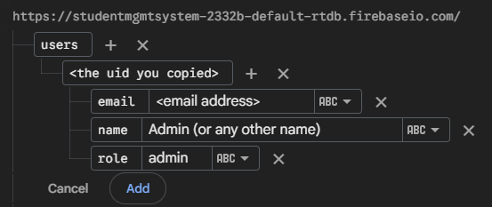
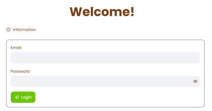
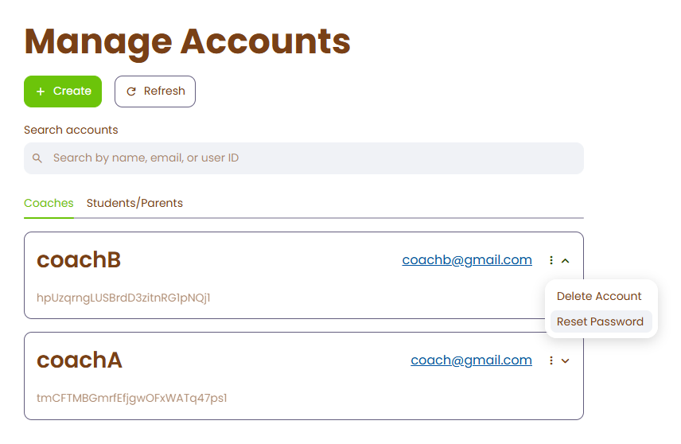
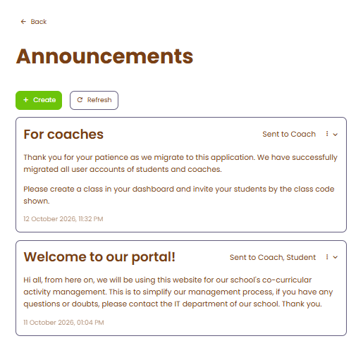
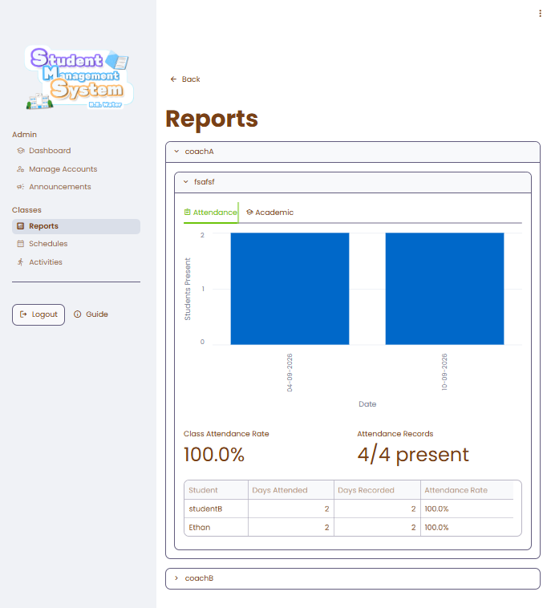

 

# Student Management System
A web application for managing after-school activities with different user roles using Firebase, MongoDB and Python with Streamlit

# Features:
- Account management
- Classes
   - Task management
   - Reports
   - Attendance
   - Schedule
- Room booking
- Announcements & Inbox
- Malay, Chinese and English Localizations

# Setting up
## Requirements
You must have installed:
- Python 3.12 or above
- Git
You must have access to:
- Firebase: https://console.firebase.google.com/
- MongoDB: https://www.mongodb.com/cloud/atlas/

## Cloning the repo
1) Clone the repo
```bash
git clone https://github.com/Eth4nplays/StudentMgmtSystem.git
```
2) Enter the repo folder
```bash
cd StudentMgmtSystem
```

## Installing dependencies
1) Run the following:
```bash
python -m pip install -r requirements.txt
```

## Creating Firebase project
1) Create a Firebase project on https://console.firebase.google.com/
2) Set up Authentication
   - Select from the sidebar: Security > Authentication
   - Enable authentication in the project
   - Add the "Email/Password" provider for authentication
3) Set up Realtime Database
   - Select from the sidebar: Databases & Storage > Realtime Database
   - Enable realtime database with the **United States (us-central1)** server selected
   - Select the **test mode** security rule *(we selected test mode for demonstration and debugging purposes only. for deployment, proper rules should be configured)*
4) Get API key by creating a web app within the console
   - Select from the sidebar: Settings > General
   - Scroll down to the "Your Apps" section
   - Click on "Add App" > "Web App"
   - Copy the apiKey and databaseURL somewhere, you'll need it later.

5) Generate private key of Python Firebase Admin SDK service account
   - Select from the sidebar: Settings > Service Accounts
   - Select the "Firebase Admin SDK" tab and select "Generate new private key"
   - Download the JSON. You'll need it later.

6) Paste contents into the `.streamlit/secrets.toml` in this format:
```toml
# Paste the apiKey and databaseURL you copied into the fields below.
[firebase]
api_key = "API_KEY_HERE"
database_url = "DATABASE_URL_HERE"

# Paste each of the contents from the JSON you downloaded into the fields below.
[firebase_admin]
"type"= "service_account"
"project_id"= "PROJECT_ID_HERE"
"private_key_id"= "PRIVATE_KEY_ID_HERE"
"private_key"= "PRIVATE_KEY_HERE"
"client_email"= "CLIENT_EMAIL_HERE"
"client_id"= "CLIENT_ID_HERE"
"auth_uri"= "AUTH_URI_HERE"
"token_uri"= "TOKEN_URI_HERE"
"auth_provider_x509_cert_url"= "AUTH_PROV_CERT_URL_HERE"
"client_x509_cert_url"= "CLIENT_CERT_URL_HERE"
"universe_domain"= "UNIV_DOMAIN_HERE"
```

## Creating MongoDB Database
1) Setting up MongoDB account & project 
   - Create an account in MongoDB Atlas on https://cloud.mongodb.com/
   - Create a project in MongoDB Atlas
2) Setting up a cluster
   - Create a cluster in your project *(you can use the free plan for now)*
   - Copy the password for the database user to somewhere, you'll need it later
3) Pasting secrets for connection to database
   - Enter the cluster, select "Connect" > "Drivers and Client Libraries"
   - Select "Python" as the language and "PyMongo (Synchronous)" as Client Library
   - Copy the connection string, replace the `<db_password>` inside with the password you copied
   - Paste content into the `.streamlit/secrets.toml` in this format:
   ```toml
   # You can paste this below the Firebase secrets
   [mongodb]
   uri = "CONNECTION_STRING_HERE"
   ```

## Creating admin account
1) Go back to your Firebase project
2) Create user in authentication
   - Select from the sidebar: Security > Authentication
   - Select "Add user" and input email and password
   - Copy the newly created user UID, you'll need it later
3) Set user as administrator
   - Select from the sidebar: Databases & Storage > Realtime Database
   - Set the user's role using the following structure:
   
   

## Running the application
1) Running the program
Run the following:
```bash
python -m streamlit run
```
2) Streamlit will provide a URL. Open it in your browser to start using the app.

# Usage of application

## Administrator

### Log into the admin account
   - On first launch, you will be shown a log in page.
   - Log into the admin account you have created earlier on.
   
   
### Creating accounts for students/parents and coaches
   - Once logged in, you will enter the dashboard.
   - Select **[Manage Accounts]** > **[+ Create]** to create an account
   - Input the new user information
      - You can give the user a role of either "Coach" or "Student/Parent".
      - Type the name and email of the user.
      - Give a temporary password for the user. They can use this to log in.
   - Select **[Create Account]** to create the account.
   - *\*Optional:* Enter the tab of the role of the user, and select **[Reset Password]** in the dropdown menu to let them create their own password.
   - You should create at least one coach and student/parent account to log in and test.

   

### Sending announcements
   - Admins can send important announcement to selected roles/individuals. Here is how it can be used.
   - In the dashboard or sidebar, select **[Announcements]** > **[+ Create]**
   - Input announcement information
      - In the **Content** tab, you can input the announcement information, example its title and content.
      - In the **Recepients** tab, you can select who can see the announcement. You can send by roles or individuals.
   - Select **[Submit]** to send the announcement.

   

### Managing classes
   - Under the "Classes" section of the sidebar, or the respective "Reports", "Schedules", and "Activities" buttons on the dashboard, you can manage and view class reports and activities.
   - Currently, there are no classes created by coaches yet, therefore this page will not be used at the moment.
   - Below is an example of a page under the "Classes" section.
   

### Managing rooms
   - In the dashboard or sidebar, select **[Room Booking]** to add rooms and view their bookings by date and time.
   - Coaches can book an available room and time from **[Room Booking]** by selecting one of their classes. Overlapping bookings are rejected.

## Coach

### Log into a coach account
   - On first launch, you will be shown a log in page.
   - Log into the coach account you have created earlier on.
### Creating a class
   - In the dashboard once logged in, at the bottom of the dashboard, select the **[+ Create Class]** button.
   - Input the class information
      - Class name
      - Class schedule
   - Select **[Create Class]** to create the class
   - Within the dashboard, you can view the class code for students to join.
### Managing a class
   - In the dashboard, select **[View Class]** in the newly created class.
   - You can manage Activities, Attendance, Reports, Schedule, and the class members.
      - Activities: The after-school activities. They can be graded, and due dates can be set alongside the activity information (eg. title and description). Students can submit file or text submissions.
      - Attendance: By selecting a date, coaches can mark attendance of students and **[Submit]** the attendance record.
      - Reports: Auto-generated reports of class attendance and academic performance. This includes the grades in activities, individual attendance and attendance rate of class.
      - Schedule: Coaches can view and edit the schedule of the after-school class.
      - People: Coaches can view or remove students from the class.
### View inbox messages
   - In the dashboard or sidebar, there is a **[Inbox]** option. This is where the announcements are shown in.
   - In the dashboard, an exclamation mark **[!]** will be shown alongside the button to indicate unread messages.

## Student/Parent

### Log into a student/parent account
   - On first launch, you will be shown a log in page.
   - Log into the student/parent account you have created earlier on.
### Joining a class
   - In the dashboard once logged in, at the bottom of the dashboard, select the **[+ Join Class]** button.
   - Input the class code.
   - Select **[Join Class]** to create the class
### Viewing and participating in class
   - In the dashboard, select **[View Class]** in the newly joined class.
   - You can view Activities, Reports, Schedule, and the class members.
      - Activities: The after-school activities. You can view the information and due date, and submit your work through text or file submission.
      - Reports: Auto-generated reports of your class attendance and academic performance. This includes your grades in activities, your attendance and attendance rate.
      - Schedule: You can view the class schedule.
      - People: You can view who is in your class and your coach.
### View inbox messages
   - In the dashboard or sidebar, there is a **[Inbox]** option. This is where the announcements are shown in.
   - In the dashboard, an exclamation mark **[!]** will be shown alongside the button to indicate unread messages.
   - You can get notification in here when your coach has graded your work.
